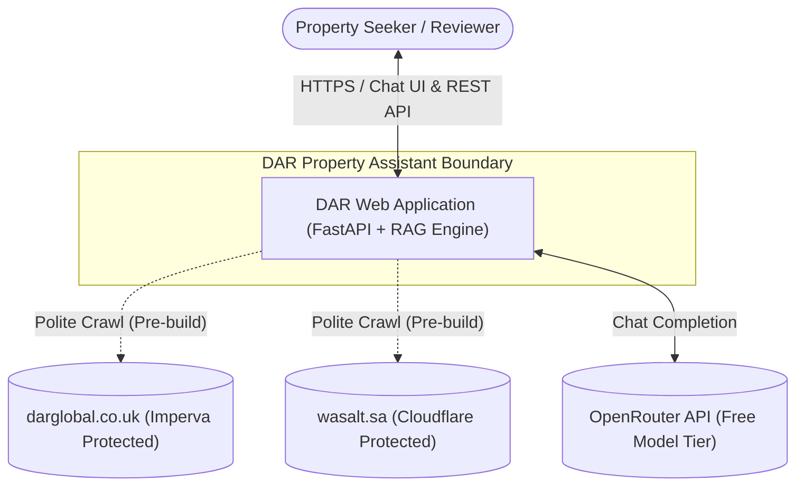
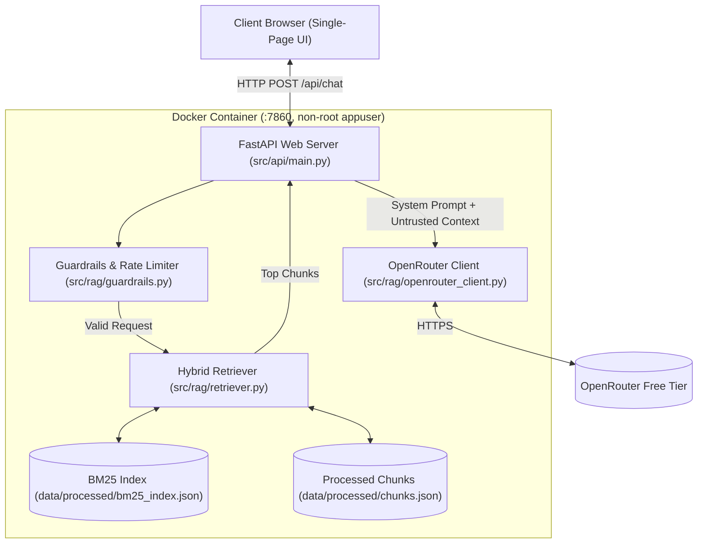
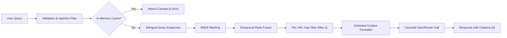

# DAR Architecture Specification (arc42 & C4)

- **Tracked in:** DAR-42
- **System:** DAR — DarGlobal AI Property Assistant
- **Framework:** arc42 (Sections 1, 3, 4, 5, 6, 8, 9, 11) + C4 Model

---

## 1. Introduction and Goals

DAR is an agentic, retrieval-augmented property assistant that answers real estate inquiries for DarGlobal's international luxury developments and Wasalt's Saudi Arabian property listings.

### Quality Goals
1. **Factual Grounding:** Zero hallucination of prices, dates, or unit specifications. Answers must cite verified scraped sources.
2. **Security & Privacy:** Block prompt injection attempts, zero storage of seller personal data (PII), zero committed secrets.
3. **Availability & Low Cost:** Operates 100% within free-tier OpenRouter models and zero-cost cloud hosting.

---

## 2. C4 Context Diagram

---

## 3. C4 Container Diagram

---

## 4. C4 Component Diagram (RAG Pipeline)

---

## 5. Building Block View (arc42 Section 5)

| Component | Responsibility | File Path |
|---|---|---|
| `RobotsChecker` | RFC 9309 wildcard robots.txt parser and policy enforcement | `src/scraper/robots_checker.py` |
| `PoliteFetcher` | Rate limiting, backoff retries, and challenge page detection | `src/scraper/fetcher.py` |
| `Cleaner` | Unicode normalization, boilerplate removal, and regex PII scrubbing | `src/processing/cleaner.py` |
| `Chunker` | Structured chunking for FAQ pairs, listing offers, and text pages | `src/processing/chunker.py` |
| `BM25Index` | Self-contained inverted index supporting English and Arabic tokens | `src/processing/index_builder.py` |
| `HybridRetriever` | RRF score fusion, bilingual query expansion, per-URL chunk capping | `src/rag/retriever.py` |
| `Guardrails` | Length validation, OWASP prompt injection blocker, IP rate limiter | `src/rag/guardrails.py` |
| `OpenRouterClient` | Multi-model fallback cascade, error mapping, API key sanitization | `src/rag/openrouter_client.py` |
| `FastAPIServer` | Exposes `/api/chat`, `/health`, `/api/stats`, `/openapi.yaml`, and UI | `src/api/main.py` |

---

## 6. Design Decisions (arc42 Section 9)
All architectural decisions are formally recorded as MADR ADRs:
- **ADR-0001:** Retrieval-Augmented Generation (RAG) Architecture
- **ADR-0002:** Hybrid Retrieval Index Architecture (BM25 + Dense Vectors)
- **ADR-0003:** OpenRouter Model Selection & Cascade Fallback Strategy
- **ADR-0004:** Fallback Strategy for Bot-Protected Static Fetching (Playwright)
- **ADR-0005:** Cloud Hosting Platform Selection (Hugging Face Spaces / Render)

---

## 7. Security Concept (arc42 Section 8 & OWASP LLM)
1. **Zero Committed Secrets:** Repository scanned with automated scripts. `OPENROUTER_API_KEY` injected only at runtime via host secrets.
2. **Untrusted Context Isolation:** Scraped text is wrapped in `[CONTEXT - UNTRUSTED RETRIEVED DATA]` blocks with explicit instructions preventing indirect prompt injection.
3. **No Seller PII:** Seller names, private phones, and WhatsApp links dropped at extraction and regex-scrubbed.
4. **Container Isolation:** Docker container executes under unprivileged UID 1000 (`appuser`).
